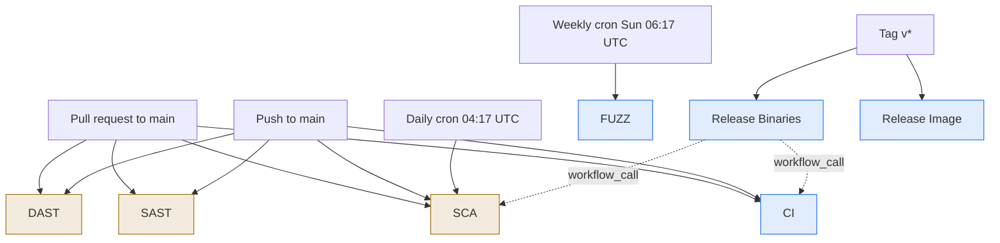
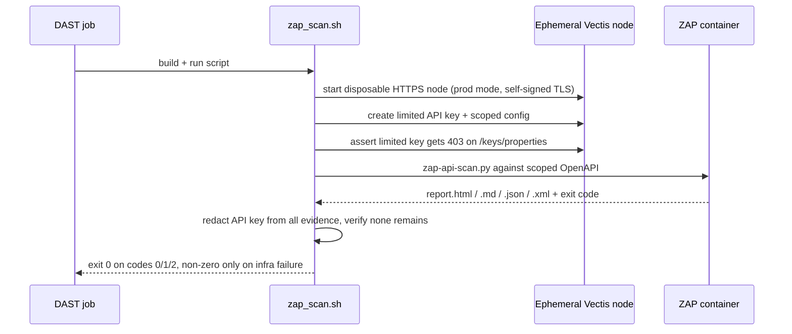
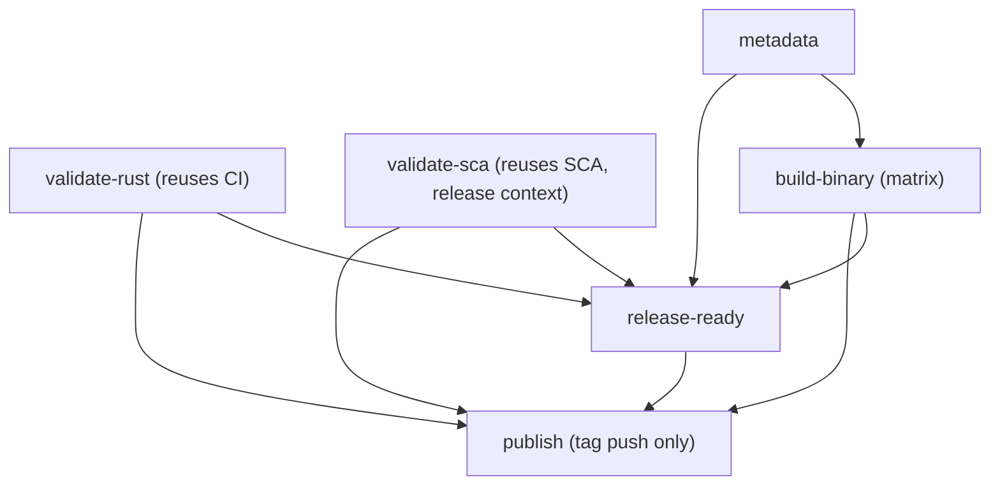
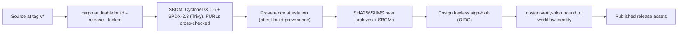

# Vectis CI/CD Pipelines

## Purpose

This document is the single authoritative reference for the Vectis CI/CD
pipelines. It describes every GitHub Actions workflow in `.github/workflows/`:
what it does, when it runs, whether it blocks or only reports, what evidence it
produces, and how the release workflows form an end-to-end supply-chain chain of
trust.

It is written for two audiences: contributors who need to understand or
reproduce a CI result locally, and external reviewers or auditors who need to
assess the controls without reading YAML. Facts here are sourced from the
workflow and script files; when in doubt, the `.github/workflows/*.yml` files and
the scripts they call are authoritative.

Related documents: [Test.md](Test.md) covers how to run the equivalent checks
locally in depth; [Build.md](Build.md) covers the release build and SBOM
mechanics; [ThreatModel.md](ThreatModel.md) and [SelfAssessment.md](SelfAssessment.md)
cover the security model these pipelines enforce.

## Pipeline map

Seven workflows run across three moments: pull requests and pushes to `main`
(validation), scheduled scans (continuous assurance), and version tags
(release). The release workflow reuses the CI and SCA workflows, and publishing a
container image is a separate tag-triggered workflow.

Blue = pipelines whose core gate blocks the merge or release. Amber = pipelines
that are report-only or mixed (findings are surfaced but do not fail by default;
see the policy table). CI, FUZZ, Release and Release Image block; SAST and DAST
are report-only on findings; SCA is mixed (its dependency audit blocks, its other
checks report).

## Trigger matrix

| Workflow | PR → main | Push → main | Cron | Tag `v*` | Manual | Reusable (`workflow_call`) |
|---|---|---|---|---|---|---|
| CI | yes | yes | — | — | yes | yes |
| SAST | yes (PR to any branch `**`) | yes | — | — | yes | — |
| DAST | yes | yes | — | — | yes | — |
| SCA | yes | yes | daily `17 4 * * *` + `branch_protection_rule` | — | yes | yes |
| FUZZ | — | — | weekly `17 6 * * 0` | — | yes | — |
| Release Binaries | — | — | — | yes | yes | — |
| Release Image | — | — | — | yes | yes (`push_image` input) | — |

## Blocking vs. report-only policy

A gate is **blocking** when a finding fails the job (and therefore, if it is a
required check, blocks the merge or release). It is **report-only** when findings
are surfaced to code scanning / step summaries / artifacts but do not fail the
job; in those workflows only a scanner infrastructure failure fails the job.

| Workflow | Blocking | Report-only | Exact gate logic |
|---|---|---|---|
| CI | fmt, clippy `-D warnings`, tests, `bash -n` script lint, build | — | any job step failure |
| SAST | Semgrep scanner error (exit `≥2`); Zizmor findings on fork PRs; Gitleaks leak | CodeQL and Semgrep findings → code scanning | Semgrep enforce step runs when `status != 0 && status != 1`, then `exit 1` |
| DAST | ZAP infrastructure failure (exit `≥3`) | all ZAP alerts (`report-only`) | ZAP exit mapping `0`/`1`/`2` = ok, else `exit $status` |
| SCA | `cargo audit` (always); Python Trivy HIGH/CRITICAL **with a fix** in `ci` context | Python findings in `release` context; Scorecard; dependency-review | `sys.exit(1 if context == "ci" and findings else 0)`; rust audit propagates `exit $status` |
| FUZZ | any crash / sanitizer finding | — | runner ends on `(( failed == 0 ))` |
| Release Binaries | CI + SCA + SBOM/PURL/checksum validation + signature verification | SCA HIGH/CRITICAL deps are report-only in `release` context | hard `exit` / `diff -u` on SBOM and checksum checks; `cosign verify-blob` required |
| Release Image | Trivy `CRITICAL,HIGH` **fixable** + SBOM/attestation/manifest verification | unfixed vulnerabilities ignored | SARIF Trivy step `severity: CRITICAL,HIGH`, `ignore-unfixed: true`, `exit-code: "1"` |

## Per-workflow reference

### CI (`ci.yml`)

Rust validation plus a Python integration smoke test. This is the primary
pull-request gate.

- **Triggers:** `pull_request` and `push` to `main`, `workflow_dispatch`, and
  `workflow_call` (reused by the release workflow).
- **Concurrency:** `rust-validation-<event>-<ref>`, cancel-in-progress.
- **Permissions:** top-level `contents: read` only; no job-level escalation.
- **Jobs:**
  - `verify` — checks out at `github.sha` and asserts `HEAD == GITHUB_SHA`;
    seeds SQLite from `src/db/sqlite_schema.sql`; runs `cargo fmt --check`;
    measures coverage with `cargo-llvm-cov` (`--locked --all-targets
    --all-features --no-report`) and writes a coverage table to the step
    summary; runs `cargo clippy --all-targets --all-features -- -D warnings`;
    `bash -n`-lints the project script set; `cargo build --locked
    --all-features`; uploads the debug binary as `vectis-bin`.
  - `integration` (`needs: verify`) — downloads `vectis-bin`, runs
    `tests/ci/run-integration.sh` and an HTTPS readiness smoke via
    `tests/ci/test-tls.sh`, and summarizes the HTTP fuzz campaigns.
- **Policy:** blocking. `fmt --check`, `-D warnings`, failing tests, script
  syntax errors and build failures all fail the job. Coverage is **measured and
  reported but not gated** (no minimum threshold enforced).
- **Evidence:** `vectis-bin`; `http-fuzz-summaries-<run_id>` (30 days) and, on
  failure, `http-fuzz-findings-<run_id>` (30 days). No SARIF.

### SAST (`sast.yml`)

Static analysis bundle: four analyzers in one workflow.

- **Triggers:** `push` to `main`, `pull_request` to any branch (`**`),
  `workflow_dispatch`. CodeQL, Semgrep and Gitleaks additionally gate on the PR
  targeting `main`; Zizmor runs on push or any PR.
- **Permissions:** top-level `permissions: {}` (empty). Each job is granted only
  what it needs, typically `contents: read` plus `security-events: write` to
  upload SARIF.
- **Jobs:** `codeql` (languages `actions` and `rust`, build-mode none),
  `semgrep` (Semgrep CE with the `p/default` ruleset, pinned container image),
  `gitleaks` (full-history secret scan with `.gitleaks.toml`), `zizmor`
  (GitHub Actions workflow linter).
- **Policy:** mixed. CodeQL and Semgrep **report** findings to code scanning;
  Semgrep **blocks only on a scanner error** (exit code `≥2`). Gitleaks fails on
  a detected leak. Zizmor **blocks on findings** for fork PRs (where code
  scanning upload is unavailable) and reports to code scanning otherwise.
- **Evidence:** `semgrep-ce-report` (14 days); SARIF categories `semgrep-ce`,
  `gitleaks`, `/language:actions`, `/language:rust`; Semgrep job summary with
  engine version, ruleset source and exit-code legend.

### DAST (`dast.yml`)

Dynamic scan of a disposable, running Vectis node with OWASP ZAP. The mechanics
are in `tests/security/zap/zap_scan.sh`.

- **Triggers:** `pull_request` and `push` to `main`, `workflow_dispatch`.
- **Permissions:** top-level `contents: read` only.
- **Job (`scan`):** builds Vectis, then runs `tests/security/zap/zap_scan.sh`,
  which stands up an ephemeral HTTPS node, provisions a **least-privilege
  synthetic API key**, generates a scoped OpenAPI document, and runs
  `zap-api-scan.py` in a pinned ZAP container. A Python step parses the ZAP
  report into the step summary.
- **Policy:** **report-only.** Alerts never fail the job; only a ZAP
  infrastructure failure does. The scanner exit code maps as: `0` = no alerts,
  `1` = FAIL-level alerts (reported), `2` = WARN-level alerts (reported), any
  other value = infrastructure failure, which fails the job.
- **Evidence:** `zap-api-scan-<run_id>` (30 days) with HTML/Markdown/JSON/XML
  reports, logs and `zap-exit-code.txt`. The synthetic API key is redacted from
  all evidence, and the job fails if the key still appears in any file.

### SCA (`sca.yml`)

Software-composition analysis across the Rust and Python dependency sets, plus
OpenSSF Scorecard.

- **Triggers:** `pull_request` and `push` to `main`, `branch_protection_rule`,
  daily `schedule` at `17 4 * * *` (04:17 UTC), `workflow_dispatch`, and
  `workflow_call` with a `validation-context` input (default `ci`).
- **Permissions:** top-level `contents: read`. Jobs that upload SARIF or publish
  Scorecard results are granted `security-events: write` / `id-token: write`
  individually.
- **Jobs:** `scorecard` (default-branch / scheduled, publishes results),
  `dependency-review` (PR only, posts a summary comment), `rust-audit`
  (`cargo audit` over `Cargo.lock` and `fuzz/Cargo.lock`), `python-sca`
  (Trivy scan of the Python lockfile with a policy step).
- **Policy:** mixed and context-dependent. `cargo audit` **always blocks** (its
  exit code is propagated). The Python SCA counts only **HIGH/CRITICAL
  vulnerabilities that have a fixed version** as findings, and blocks **only in
  `ci` context** — in `release` context the same findings are report-only.
  Scorecard and dependency-review are report-only.
- **Evidence:** `sca-rust-*` and `sca-python-*` artifacts (30 days, fail if
  missing), Scorecard SARIF, and recorded scanner versions/config for audit.

### FUZZ (`fuzz.yml`)

Scheduled native fuzzing with `cargo-fuzz`.

- **Triggers:** weekly `schedule` at `17 6 * * 0` (Sundays 06:17 UTC), and
  `workflow_dispatch` with a `minimize_corpus` input (runs `cargo fuzz cmin`
  instead of fuzzing when true).
- **Concurrency:** `cargo-fuzz-<ref>`, **cancel-in-progress disabled** so long
  runs are not interrupted. Job timeout 240 minutes.
- **Permissions:** top-level `contents: read` only.
- **Job (`fuzz`):** installs a pinned nightly toolchain and `cargo-fuzz`,
  restores the accumulated corpus from cache, builds the targets, and runs
  `./tests_cargo-fuzz.sh`.
- **Policy:** blocking. Any crash or sanitizer finding fails the job. Budget per
  target is 300 seconds; `KEEP_GOING` lets all targets run before failing.
- **Invariant:** the runner declares **27 fuzz targets** (23 fast structural +
  4 slow crypto round-trip) and fails if the declared target count drifts from
  `EXPECTED_TARGETS`.
- **Evidence:** `cargo-fuzz-results-<run_id>` (30 days) with the log and any
  crash artifacts; the corpus is persisted via cache.

### Release Binaries (`release.yml`)

Builds, attests, signs and publishes the release binaries. It reuses CI and SCA
as gates before building.

- **Triggers:** `push` of tags matching `v*`, and `workflow_dispatch`.
- **Permissions:** top-level `contents: read`; write scopes (`id-token`,
  `attestations`, `contents: write`) are granted only to the build and publish
  jobs.
- **Jobs and dependencies:**

- **What build-binary does:** `cargo auditable build --release --locked` across
  a target matrix; Trivy generates an SBOM and converts it to **CycloneDX 1.6**
  and **SPDX-2.3**, validating that PURL sets match across source/CycloneDX/SPDX;
  it records a `build-info.json` (binary SHA-256, tool versions, Botan native
  source URL and verified checksum); and it attests build provenance.
- **What publish does:** generates `SHA256SUMS` (cross-checked against each
  `build-info.json`), signs it with keyless **Cosign** (`sign-blob`), verifies
  the signature against the expected workflow identity, and uploads the release
  assets.
- **Policy:** blocking throughout. The release is gated on CI, SCA, metadata and
  build; SBOM/PURL/checksum validations hard-fail; signature verification is
  required. (In `release` context SCA's HIGH/CRITICAL dependency findings are
  report-only, but `cargo audit` still blocks.)
- **Evidence / published assets:** `release-*` and `sbom-binary-*` artifacts
  (30 days); published assets include the tarballs, both SBOMs, `build-info.json`,
  `SHA256SUMS` and the Cosign signature bundle.

### Release Image (`release-image.yml`)

Builds, scans, SBOMs, attests and publishes the multi-arch container image
(`docker.io/liesware/vectis`).

- **Triggers:** `push` of tags matching `v*`, and `workflow_dispatch` with a
  `push_image` input (publishing only happens when pushing a tag, or when
  `push_image` is true on `main`).
- **Permissions:** top-level `contents: read`; the publish job additionally gets
  `id-token`, `attestations` and `security-events` write, and runs in the
  `Release` environment.
- **Jobs:** `metadata` resolves the tag and whether to publish; `build-image`
  (when not publishing) builds per-arch images, generates and validates per-arch
  SBOMs, and runs the Trivy gate; `publish-image` builds and pushes by digest per
  architecture, attests both SBOMs with Cosign, promotes the two digests into the
  tag, and attests the published manifest's provenance.
- **Policy:** blocking. The Trivy gate fails on any **fixable** `CRITICAL,HIGH`
  vulnerability (`ignore-unfixed: true`); SBOM, attestation and manifest
  verifications must pass. In the publish job the gate steps are
  `continue-on-error` but their outcomes are re-asserted in a later validation
  step, so a gate failure still fails the job.
- **Evidence:** `sbom-image-*` artifacts (30 days) and `trivy-image-report*`
  (14 days); SARIF categories `trivy-image` and `trivy-image-arm64`.

## Supply-chain trust chain

The release workflows produce signed, attested artifacts built from pinned,
checksum-verified sources. The chains for the binaries and the image mirror each
other:

Key properties:

- **Dual-format SBOM.** Every released binary and image carries both a
  CycloneDX 1.6 and an SPDX-2.3 SBOM, generated by Trivy and validated so that
  the component PURLs agree across source, CycloneDX and SPDX. `cargo auditable`
  additionally embeds dependency metadata in the binary itself.
- **Keyless signing with an OIDC identity.** Cosign signs with a short-lived
  certificate issued to the GitHub Actions OIDC token; there is no long-lived
  signing key. Verification is **bound to the exact workflow identity**:
  `https://github.com/<repo>/.github/workflows/release.yml@refs/tags/<tag>` for
  the binaries, and `.../release-image.yml@<ref>` for the image SBOM
  attestations, with issuer `https://token.actions.githubusercontent.com`.
  Changing the workflow file path or the ref that produced an artifact changes
  that identity, so a verifier pinned to the expected identity will reject
  artifacts not produced by the intended workflow.
- **Image digests.** The image is built and pushed **by digest** per
  architecture, the digests are validated and promoted into the tag, and the
  final manifest is verified to contain exactly the two platform digests.

To verify a release locally, download `SHA256SUMS`, `SHA256SUMS.sigstore.json`
and the artifacts, then run `cosign verify-blob` with the identity above, and
`sha256sum -c SHA256SUMS`.

## Findings governance and false-positive triage

Findings reach reviewers through three channels: **SARIF** uploaded to GitHub
code scanning (CodeQL, Semgrep, Gitleaks, Scorecard, Trivy), **step summaries**
(CI coverage, HTTP fuzz, ZAP risk table, Trivy tables), and **evidence
artifacts** retained for 14–30 days.

Report-only findings (DAST, most SAST, SCA's non-audit checks) are not silently
dropped: they must be triaged. A false positive is documented with its
justification rather than suppressed blindly, so an auditor can see why a flagged
item was dismissed.

**Worked example — ZAP SQL Injection [40018].** The DAST scan reports a High
"SQL Injection" alert on `POST /commit/verify`, `/commit/verify/batch`,
`/mac/verify` and `/mac/verify/batch` (parameters `commitment` / `digest`). This
is a **false positive**: all four endpoints return `400 Bad Request` to the
injected payload (input validation rejecting it, the opposite of a successful
injection); the alert's Evidence field is empty (ZAP's boolean/response-length
heuristic, not an observed SQL error); and Vectis accesses storage through
parameterized SQLx queries, with these endpoints processing
`commitment`/`digest` as cryptographic inputs rather than SQL fragments. The
triage record is the justification above; the alert stays visible in the DAST
evidence rather than being hidden by a suppression rule.

## Required checks and branch protection

Which checks are **required to merge** is GitHub branch-protection configuration,
not part of the workflow files, and is maintained out of band on the repository.
The intended required set for `main` is the four validation workflows that run on
pull requests: **CI** (both `verify` and `integration`), **SAST**, **DAST** and
**SCA**. FUZZ is a scheduled assurance workflow, and the release workflows run on
tags, so neither is a pull-request gate.

Because this is out-of-band configuration, this document describes the intended
state only; the live setting is whatever the repository's branch-protection rules
currently enforce.

## Cross-cutting conventions

- **Action pinning.** Every action is pinned to a full 40-character commit SHA
  with a `# vX` version comment. Container images (Semgrep, ZAP, build images)
  are pinned by `@sha256:` digest; the ZAP script refuses to run on an
  unpinned image.
- **Least privilege.** Workflows default to `contents: read` (SAST uses an empty
  `permissions: {}`), and elevate to `security-events`, `id-token` or
  `attestations` write only on the specific jobs that need them.
- **No persisted credentials.** `persist-credentials: false` is set on every
  `actions/checkout`.
- **Concurrency.** Validation workflows cancel superseded runs
  (`cancel-in-progress: true`); SAST scopes concurrency per scanner job. The
  long-running Release, Release Image and FUZZ workflows do not cancel runs in
  progress.
- **No long-lived signing secrets.** Signing and provenance use GitHub OIDC
  (keyless Cosign + attestations), not stored private keys.

## Maintenance

- **Dependency updates.** Dependabot keeps two ecosystems current, each on a
  monthly schedule and grouped into a single PR: `github-actions` (repository
  root) and `docker` (`/image`).
- **Pinned digests.** When Dependabot or a maintainer bumps an action or image,
  the pinned SHA / `@sha256:` digest and its version comment are updated
  together; the pinned-tool version assertions in SCA, DAST and the release
  workflows must be bumped in step.
- **Cron cadence.** SCA runs daily at 04:17 UTC; FUZZ runs weekly on Sundays at
  06:17 UTC. These are the only scheduled runs.

## Local reproduction

Each pull-request gate has a local equivalent:

| CI check | Local command |
|---|---|
| Formatting | `cargo fmt --check` |
| Coverage / tests | `cargo llvm-cov --locked --all-targets --all-features` |
| Lints | `cargo clippy --all-targets --all-features -- -D warnings` |
| Build | `cargo build --locked --all-features` |
| Rust dependency audit | `cargo audit --file Cargo.lock` |
| Dynamic API scan (DAST) | `bash tests/security/zap/zap_scan.sh` |
| Native fuzzing | `./tests_cargo-fuzz.sh` |

See [Test.md](Test.md) for prerequisites and the detailed walkthrough of each.
